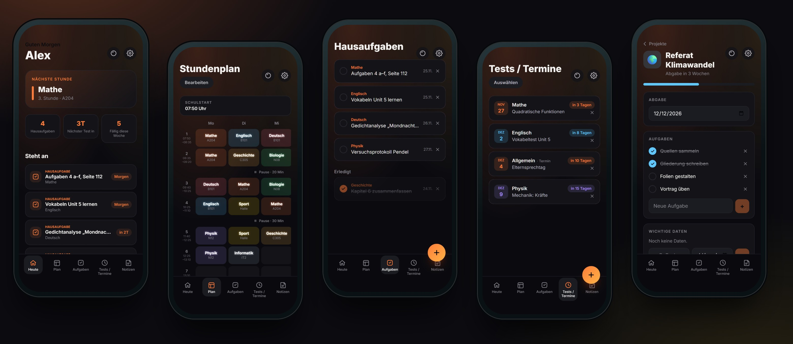
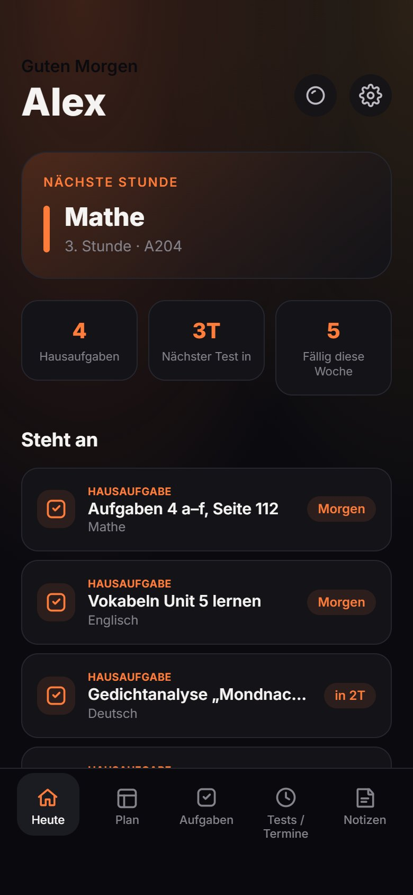
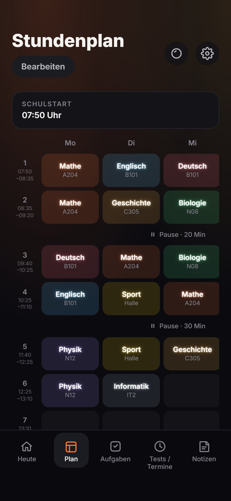
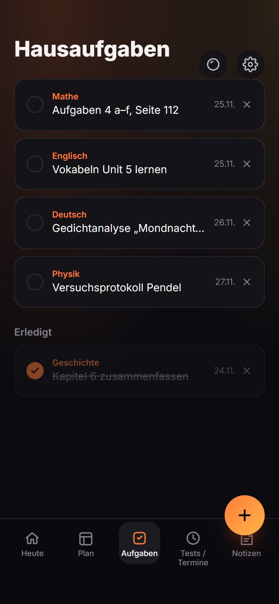
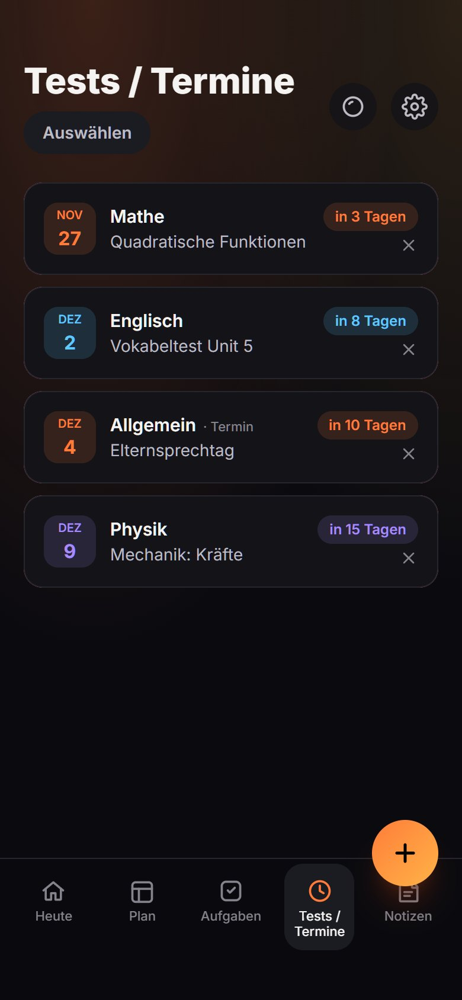
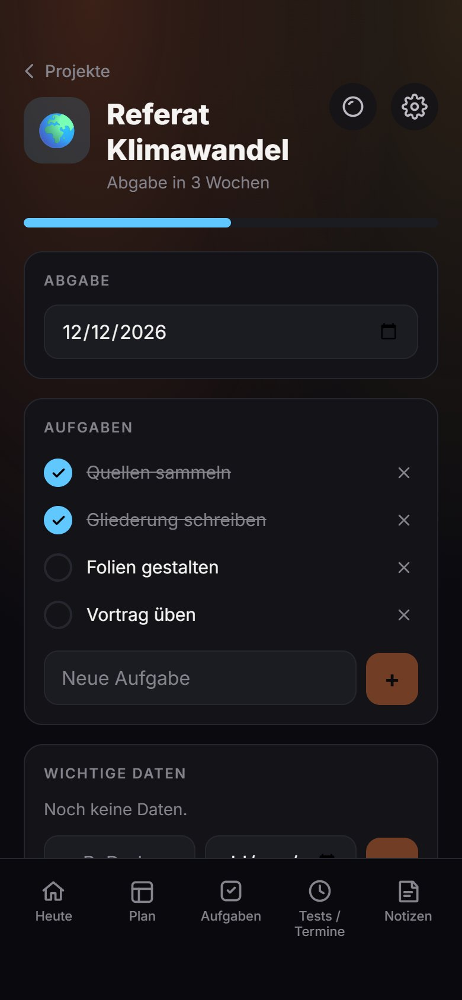

<div align="center">


# Schultracker

**Der Schulalltag in einer App.**<br>
Stundenplan, Hausaufgaben, Tests, Notizen und Projekte, offline-fähig und als App installierbar.

<br>

<a href="https://schultracker.vercel.app"></a>

<br>


<br><br>



</div>

<br>

Der Schulalltag in einer App: **Stundenplan, Hausaufgaben, Tests & Termine, Notizen und Projekte**, installierbar als Progressive Web App (PWA) auf iPhone, iPad und Desktop.

## Screenshots

<table>
  <tr>
    <td align="center" width="20%"><br><sub>Heute</sub></td>
    <td align="center" width="20%"><br><sub>Stundenplan</sub></td>
    <td align="center" width="20%"><br><sub>Aufgaben</sub></td>
    <td align="center" width="20%"><br><sub>Tests & Termine</sub></td>
    <td align="center" width="20%"><br><sub>Projekt</sub></td>
  </tr>
</table>

## ✨ Features

- **Stundenplan** – Wochenraster mit Fächerfarben, Doppelstunden, konfigurierbaren Pausen und Schulstart; Uhrzeiten werden daraus automatisch berechnet.
- **Home-Dashboard** – „Nächste Stunde“, Countdown zum nächsten Test und ein „Steht an“-Feed, der sich jede Minute selbst aktualisiert.
- **Hausaufgaben** – mit Fälligkeitsdatum (inkl. „nächste Stunde“-Button), Abhaken und Wisch-zum-Löschen.
- **Tests & Termine** – Unterscheidung Test/Termin, Foto-Anhänge und **.ics-Export** in den Kalender.
- **Notizen & Handschrift** – Text oder Skizze per Apple Pencil (Palm-Rejection durch reinen Stift-Modus).
- **Projekte** – Aufgabenlisten, Termine, Links, Notizen und Foto pro Projekt.
- **Bubble** – Hausaufgaben, Tests, Projekte und Stundenplan mit Freunden teilen (Beitritt per Code oder QR-Code, Echtzeit-Sync).
- **Push-Benachrichtigungen** – Erinnerungen für Hausaufgaben und Tests (iOS nur als installierte Home-Bildschirm-App).
- **Offline-fähig** – lokaler Firestore-Cache und Service Worker.

## 🧱 Tech-Stack

| Bereich | Technologie |
| --- | --- |
| Frontend | React 19, Vite, React Router 7 |
| Styling & Animation | Tailwind CSS v4, Framer Motion |
| Backend | Firebase Auth (E-Mail/Passwort & Google) + Firestore |
| PWA | `vite-plugin-pwa` (Workbox) |
| Serverless | Vercel Functions in `api/` (`firebase-admin`) |
| Hosting | Vercel |

## 🚀 Loslegen

### Voraussetzungen

- Node.js **22.x**
- Ein Firebase-Projekt (kostenloser Spark-Plan reicht)

### 1. Firebase einrichten

1. Auf [console.firebase.google.com](https://console.firebase.google.com) ein Projekt anlegen.
2. **Authentication** → Anbieter *E-Mail/Passwort* (und optional *Google*) aktivieren.
3. **Firestore Database** erstellen (Production-Modus).
4. Den Inhalt von [`firestore.rules`](./firestore.rules) unter **Firestore → Regeln** einfügen und veröffentlichen.
5. Eine Web-App hinzufügen und die Config-Werte kopieren.

### 2. Umgebungsvariablen

`.env.example` nach `.env` kopieren und ausfüllen:

```env
VITE_FIREBASE_API_KEY=
VITE_FIREBASE_AUTH_DOMAIN=
VITE_FIREBASE_PROJECT_ID=
VITE_FIREBASE_STORAGE_BUCKET=
VITE_FIREBASE_MESSAGING_SENDER_ID=
VITE_FIREBASE_APP_ID=
```

### 3. Starten

```bash
npm install
npm run dev
```

| Befehl | Zweck |
| --- | --- |
| `npm run dev` | Entwicklungsserver |
| `npm run build` | Produktions-Build |
| `npm run preview` | Build lokal ansehen |
| `npm run lint` | Linting mit oxlint |

## ☁️ Deployment (Vercel)

1. Repo auf Vercel importieren (Vite wird automatisch erkannt).
2. Die `VITE_FIREBASE_*`-Variablen in den Project Settings eintragen.
3. Deployen – oder per CLI: `npx vercel --prod --yes`.

> ⚠️ `firestore.rules` wird **nicht** automatisch mitdeployt – Änderungen müssen manuell in der Firebase Console eingefügt werden.

**Push-Benachrichtigungen (optional)** benötigen zusätzlich `FIREBASE_SERVICE_ACCOUNT`, `CRON_SECRET` und `VITE_FIREBASE_VAPID_KEY`. Da Vercel Hobby nur tägliche Crons erlaubt, ruft ein externer Dienst (z. B. cron-job.org) alle 15 Minuten `/api/cron-notify` auf.

**Auf dem iPhone/iPad installieren:** Seite in Safari öffnen → Teilen → *Zum Home-Bildschirm*.

## 🗂️ Projektstruktur

```
├── api/              # Vercel Functions (Push-Cron, .ics-Auslieferung)
├── public/           # Icons, Firebase-Messaging-Service-Worker
├── src/
│   ├── components/   # UI-Bausteine (Sheet, Nav, Animationen, …)
│   ├── context/      # AuthContext
│   ├── lib/          # Hooks & Logik (Firestore, Bubble, Push, ics, …)
│   └── pages/        # Seiten (Home, Stundenplan, Hausaufgaben, …)
├── firestore.rules   # Sicherheitsregeln
└── vercel.json       # Rewrites (SPA-Fallback, /api ausgenommen)
```

## 🗄️ Datenmodell (Kurzfassung)

Alle persönlichen Daten liegen isoliert unter `users/{uid}/…` (`schedule`, `breaks`, `homework`, `tests`, `notes`, `projects`, `devices`). Geteilte Inhalte leben unter `bubbles/{code}/…`; Zugriff regeln die Firestore-Regeln über die Mitgliederliste.

## 🧪 Tests

Es gibt keine automatisierte Test-Suite. Geprüft wird manuell im Browser (Mobilbreiten 320–390 px) und nach dem Deploy auf einem echten iPhone – Safari-Standalone-Verhalten lässt sich in Emulatoren nicht zuverlässig nachstellen.

## 👤 Autor

Entwickelt von **Leopold N.**
